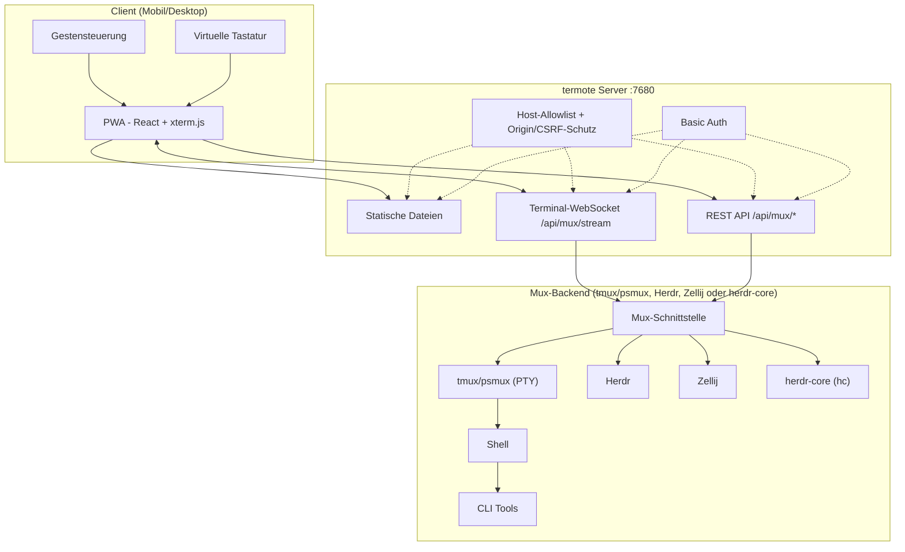
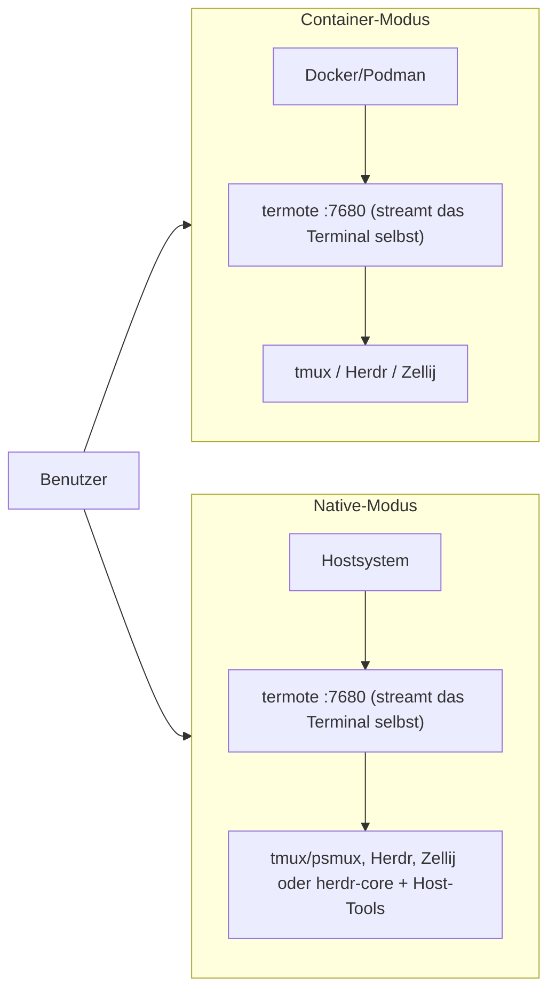

<p align="center">
  <picture>
    <source media="(prefers-color-scheme: dark)" srcset="../../assets/branding/termote/social/banner-readme-dark.svg" />
    
  </picture>
</p>

<p align="center">
  <a href="https://github.com/tsuk1nose/termote/releases"></a>
  <a href="https://github.com/tsuk1nose/termote/actions/workflows/ci.yml"></a>
  <a href="https://github.com/tsuk1nose/termote/blob/main/LICENSE"></a>
  <a href="https://github.com/tsuk1nose/termote/stargazers"></a>
</p>

<p align="center">
  
  
  
  
</p>

<p align="center">
  &nbsp;
</p>

CLI-Tools (Claude Code, Codex, OpenCode, jedes Terminal) per PWA von Mobilgeräten/Desktop fernsteuern.

> [!NOTE]
> Termote 1.0 aktualisiert keine 0.x-Installation. 0.x wie in der
> [archivierten 0.x-Dokumentation](https://github.com/tsuk1nose/termote) beschrieben
> deinstallieren und dann 1.0 mit den Befehlen aus dem [Schnellstart](#schnellstart) installieren.

> **Termote** = Terminal + Remote
>
> 🇬🇧 [English](../../README.md) | 🇻🇳 [Tiếng Việt](README.vi.md) | 🇨🇳 [简体中文](README.zh-CN.md) | 🇯🇵 [日本語](README.ja.md) | 🇰🇷 [한국어](README.ko.md) | 🇪🇸 [Español](README.es.md) | 🇧🇷 [Português (BR)](README.pt-BR.md) | 🇫🇷 [Français](README.fr.md) | 🇷🇺 [Русский](README.ru.md) | 🇮🇩 [Bahasa Indonesia](README.id.md)

<p align="center">
  <a href="https://github.com/tsuk1nose/termote"></a>
</p>

## Funktionen

- **Session-Wechsel**: Mehrere tmux-Sessions mit Erstellen/Bearbeiten/Löschen
- **Session-Tabs**: Horizontale Tab-Leiste zum schnellen Fensterwechsel
- **Herdr-Backend** (nativ oder im Container): Herdr-Workspaces statt tmux steuern, mit Statusabzeichen des Coding-Agents in jedem Pane — siehe [Native Installation](https://github.com/tsuk1nose/termote)
- **Chat-Ansicht**: Ein Pane, in dem Claude Code, Codex (mit `--no-daemon` gestartet) oder OpenCode 2 läuft, als Chat lesen und beantworten, mit Vorschlägen für Slash-Befehle, Antworten auf Dialoge und laufenden Subagents — siehe [Agent Chat](https://github.com/tsuk1nose/termote)
- **Session-Verlauf**: Die Sessions von Claude Code, Codex und OpenCode auflisten, die im Ordner eines Panes liefen, eine davon lesen, sie in einem neuen Tab fortsetzen oder eine laufende forken — siehe [Resuming an Old Session](https://github.com/tsuk1nose/termote)
- **Tokens und Kosten**: Die Tokens und die geschätzten Kosten jeder Agent-Session, mit Tagessummen — siehe [Tokens and cost](https://github.com/tsuk1nose/termote)
- **Von einer Session geänderte Dateien**: Die Dateien, die eine Agent-Session bearbeitet hat, aufgelistet in Changes und im Session-Verlauf; jede öffnet ihren Diff — siehe [Changes](https://github.com/tsuk1nose/termote)
- **Files- und Changes-Ansicht**: Das Verzeichnis eines Panes und seine Git-Änderungen durchsuchen, mit Markdown-Vorschau, auf jedem Backend einschließlich psmux unter Windows — siehe [Files and Changes](https://github.com/tsuk1nose/termote)
- **Warteschlange und Dateilinks im Chat**: eine Nachricht vormerken, während der Agent arbeitet; einen Dateipfad des Agenten antippen, um die Datei in Files an ihrer Zeile zu öffnen
- **Review und Staging**: Zeilen in Changes und Files kommentieren und das Review an einen Agenten senden; eine Änderung pro Datei oder pro Hunk stagen, unstagen oder verwerfen
- **Vorschau und Bearbeitung in Files**: PDF, .xlsx und .docx schreibgeschützt ansehen; Dateien in Shift-JIS, EUC-JP und UTF-16 öffnen und speichern; Markdown neben einer Live-Vorschau bearbeiten
- **Open in Windows** (WSL): Den Windows-Pfad einer Datei kopieren oder eine Datei bzw. einen Ordner mit dem zugehörigen Windows-Programm öffnen, wenn der Server unter WSL läuft
- **Places**: einen Ordner außerhalb des Panes mit `termote start --allow-path <dir>` in Files anbieten — siehe [Places](https://github.com/tsuk1nose/termote)
- **Tasks**: die `package.json`-Skripte und Makefile-Targets eines Panes ausführen, einen fehlgeschlagenen Lauf an einen Agenten senden — siehe [Tasks](https://github.com/tsuk1nose/termote)
- **Worktrees**: Einen Git-Worktree als eigene Gruppe öffnen, aus einem neuen oder vorhandenen Branch (Herdr, tmux, Zellij, herdr-core, psmux) — siehe [Worktrees](https://github.com/tsuk1nose/termote)
- **Eigene Fenster** (Desktop): eine Datei, einen Diff, einen Tab, ein Pane oder die Übersicht in einem eigenen Fenster öffnen
- **Bildanhänge**: Ein Bild vom Handy an das Terminal oder an eine Nachricht in der Chat-Ansicht senden, damit der Agent es über seinen Pfad lesen kann; ein in Claude Code, Codex oder OpenCode eingefügtes Bild lässt sich aus der Chat-Ansicht wieder öffnen
- **Zellij-Backend** (Linux, macOS oder im Container): Zellij-Sitzungen, -Tabs und -Panes statt tmux steuern (Zellij 0.45.0 oder neuer), gewählt mit `--mux zellij` — siehe [Native Installation](https://github.com/tsuk1nose/termote)
- **herdr-core-Backend** (nativ, jedes Betriebssystem): die Spaces, Tabs und Panes anzeigen, die die herdr-App zeigt, als weiterer Client von herdr-core (`hc` 0.1.16 oder neuer), gewählt mit `--mux hc` — siehe [herdr-core-Backend](https://github.com/tsuk1nose/termote)
- **Machines**: Die Agents der anderen Rechner von einem einzigen Termote aus beobachten und steuern, über SSH mit einem Schlüssel, der dort nur Termote erreichen kann (`termote machine add <alias>`) — siehe [Machines](https://github.com/tsuk1nose/termote)
- **Herdr-Plugin**: Das fokussierte Herdr-Pane in Termote öffnen, seinen Link als QR-Code fürs Handy anzeigen, den Server starten oder stoppen, ohne Herdr zu verlassen — siehe [Herdr Plugin](https://github.com/tsuk1nose/termote)
- **Mobilfreundlich**: Virtuelle Tastatur-Toolbar (Tab/Ctrl/Shift/Pfeiltasten, erweiterbar)
- **Gestenunterstützung**: Wischen für Ctrl+C, Tab, Scrollen
- **Befehlsverlauf**: Zuvor gesendete Befehle mit Suche abrufen
- **Schnellaktionen**: Die am Ende der mobilen Leiste fixierte ⋯-Taste zeigt eine Actions-Zeile mit häufigen Operationen (clear, cancel, exit)
- **Oberflächenstile**: Neutral, Terminal oder Native, in den Einstellungen gewählt, unabhängig vom hellen/dunklen Theme
- **Sprache der Oberfläche**: Englisch oder Vietnamesisch, in den Einstellungen gewählt; Auto folgt dem Browser
- **Einstellungen zum Mitnehmen**: Die Einstellungen dieses Browsers in eine Datei exportieren und in einem anderen importieren oder die Einstellungen prüfen, die ein Coding-Agent mit `termote settings propose` vorschlägt — siehe [Settings](https://github.com/tsuk1nose/termote)
- **GPU-Terminal**: Das Terminal wird mit WebGL2 gezeichnet, wenn das Gerät eine GPU hat; so bleiben auch große Ausgaben flüssig
- **Verbindungsanzeige**: Echtzeit-Serverstatus mit automatischer Trennungserkennung
- **Update-Prüfung**: Automatische Benachrichtigung über neue Versionen von GitHub Releases
- **PWA**: Auf dem Homescreen installierbar, offline-fähig
- **Persistente Sessions**: tmux hält Sessions am Leben
- **Einklappbare Seitenleiste**: Desktop-Oberfläche mit ein-/ausschaltbarer Session-Seitenleiste
- **Vollbildmodus**: Immersives Terminal-Erlebnis
- **Läuft als Dienst**: `termote start` registriert einen Benutzerdienst (systemd, launchd, geplante Aufgabe), der bei der Anmeldung startet
- **Konfigurationsspeicherung**: `termote start` speichert seine Optionen, das Passwort wird verschlüsselt abgelegt

## Screenshots

**[Demo ausprobieren](https://github.com/tsuk1nose/termote)**: die echte App im Browser, auf dem Handy oder am Desktop, mit erfundenen Daten und ohne Installation.

<p align="center">
  
</p>

<p align="center">
  
</p>

<p align="center">
  
</p>

<p align="center">
  
</p>

## Architektur



termote streamt das Terminal selbst (PTY unter Unix, ConPTY unter Windows) an xterm.js in der PWA; einen separaten Terminalprozess, an den weitergeleitet werden müsste, gibt es nicht mehr. Das vollständige Schutzmodell für Anfragen beschreibt [`docs/system-architecture.md`](../system-architecture.md).

## Schnellstart

> 📖 **Neu bei Termote?** Schau dir die [Erste-Schritte-Anleitung](../getting-started.md) für eine vollständige Anleitung mit Beispielen an.

**Linux / macOS:**

```bash
termote start
```

**Homebrew (macOS, Linux):**

```bash
termote start
```


**Windows (PowerShell):**

```powershell
termote start
```

**Mit einem Coding-Agent:** Füge den Prompt aus [Install with an agent](https://github.com/tsuk1nose/termote) in Claude Code, Codex oder einen anderen Agent ein. Er folgt [`agents.md`](https://github.com/tsuk1nose/termote), prüft, ob der Server antwortet, und überlässt dir das Passwort.

Der Installer braucht nur `curl`, `tar` und `sha256sum`/`shasum` (unter Windows PowerShell), weder sudo noch Administratorrechte. Er prüft die Prüfsumme des Archivs, installiert den Befehl `termote` und startet nichts. `termote start` speichert die Optionen, erzeugt beim ersten Mal ein Passwort (einmal ausgegeben, nur in einem Terminal; `termote show-password` zeigt es erneut an), registriert den Dienst und startet ihn. Danach `http://127.0.0.1:7680` öffnen (Windows: `http://127.0.0.1:7690`).

Vorher muss ein Terminal-Backend installiert sein: tmux (`sudo apt install tmux`, `brew install tmux`), unter Windows psmux (`winget install psmux`) oder [Herdr](https://github.com/tsuk1nose/termote). Der erste `start` erkennt, welches verwendet wird. [Zellij](https://zellij.dev/documentation/installation) 0.45.0 oder neuer (Linux, macOS) wird nie erkannt: wählen Sie es mit `--mux zellij`. [herdr-core](https://herdr.dev/core/) (`hc` 0.1.16 oder neuer, jedes Betriebssystem, nur nativ) wird ebenfalls nie erkannt: wählen Sie es mit `--mux hc`.

### Häufige Optionen

```bash
termote start --lan                  # Listen on the LAN, not only this machine
termote start --tailscale myhost.ts.net  # Publish over Tailscale HTTPS
termote start --mux herdr            # Drive Herdr workspaces instead of tmux
termote start --mux zellij           # Drive Zellij sessions instead of tmux (Linux, macOS)
termote start --mux hc               # Show the herdr app's terminals through herdr-core
termote start --no-auth              # Disable basic auth (local use only)
```

Die Optionen werden gespeichert: Ein nicht angegebenes Flag behält seinen gespeicherten Wert, und ein boolesches Flag wird mit `=false` ausgeschaltet (`termote start --lan=false`). Die Flags sind auf jedem Betriebssystem gleich, auch in PowerShell.

### Befehle für den Alltag

```bash
termote status                       # What the running server reports
termote stop                         # Stop (it starts again at the next login)
termote restart                      # Restart with the saved options
termote logs follow                  # Tail the logs
termote show-password                # Print the saved username and password
termote url --qr                     # The link to open, as a QR code for a phone
termote pair                         # A one-time code that signs a new device in
termote devices                      # List the paired devices (devices revoke <id>)
termote machine add <ssh alias>      # Reach another computer's Termote (Machines in the sidebar)
termote uninstall                    # Remove the service, the command, the install and uploads
```

`update` wechselt zur neuen Version, startet den Dienst neu und wechselt zurück, falls die neue Version nicht hochkommt. `uninstall` behält die Konfiguration (`~/.config/termote`) und die Logs (`~/.local/state/termote`) und gibt beide Pfade aus; `uninstall --purge` entfernt sie ebenfalls.

## Installation

### Version festlegen

```bash
```

```powershell
```


### Container-Modus

```bash
termote container up                          # Run the published image (podman or docker)
termote container up --workspace ~/projects   # Mount a directory at /workspace
termote container status
termote container logs -f
termote container down
```


> **Sicherheitshinweis**: `$HOME` nicht direkt einbinden — sensible Verzeichnisse wie `.ssh`, `.gnupg` wären im Container zugänglich. Stattdessen gezielt Projektverzeichnisse einbinden.

### Docker ohne die CLI

```bash
# Generates a password: docker exec termote cat /home/termote/.config/termote/password
docker run -d --name termote -p 7680:7680 \
  -v ~/projects:/workspace \

# With your own credentials
docker run -d --name termote -p 7680:7680 \
  -e TERMOTE_USER=admin -e TERMOTE_PASS=secret \
```

| Umgebungsvariable | Beschreibung                                                                                                     |
| ----------------- | ---------------------------------------------------------------------------------------------------------------- |
| `TERMOTE_USER`    | Benutzername für Basic Auth (Standard: `admin`)                                                                  |
| `TERMOTE_PASS`    | Passwort für Basic Auth (Standard: automatisch erzeugt, gespeichert in `/home/termote/.config/termote/password`) |
| `NO_AUTH`         | Auf `true` setzen, um die Authentifizierung abzuschalten                                                         |

### Aus dem Quellcode bauen

```bash
git clone https://github.com/tsuk1nose/termote.git
cd termote
make build
./scripts/termote.sh start
```


### Upgrade von 0.x

Ein Upgrade von 0.x gibt es nicht: 1.0 wird an einem neuen Ort installiert und liest die 0.x-Konfiguration nicht. 0.x wie in der [archivierten 0.x-Dokumentation](https://github.com/tsuk1nose/termote) beschrieben deinstallieren und dann 1.0 mit den obigen Befehlen installieren.

## Bereitstellungsmodi



| Modus     | Befehl                 | Anwendungsfall                      | Plattform             |
| --------- | ---------------------- | ----------------------------------- | --------------------- |
| Nativ     | `termote start`        | Zugriff auf Host-Tools (claude, gh) | macOS, Linux, Windows |
| Container | `termote container up` | Isolierte Umgebung                  | macOS, Linux, Windows |

Der native Server läuft als Benutzerdienst: unter Linux als systemd-User-Unit (als abgelöster Prozess, wo es kein systemd für Benutzer gibt, etwa WSL2 ohne systemd), unter macOS als launchd-Agent, unter Windows als geplante Aufgabe bei der Anmeldung.

### Optionen von `start`

| Flag                              | Beschreibung                                                                                                                                 |
| --------------------------------- | -------------------------------------------------------------------------------------------------------------------------------------------- |
| `--port <port>`                   | Port (Standard: 7680, Windows: 7690)                                                                                                         |
| `--lan[=false]`                   | Auf allen Schnittstellen lauschen (Standard: nur localhost)                                                                                  |
| `--tailscale <host[:port]>`       | Über Tailscale HTTPS veröffentlichen (Standardport 443)                                                                                      |
| `--no-tailscale`                  | Veröffentlichung über Tailscale beenden                                                                                                      |
| `--cloudflare <host>`             | Hostname eines Cloudflare Tunnels, den Sie selbst betreiben; warnt, wenn Cloudflare Access nicht davorgeschaltet ist                         |
| `--no-cloudflare`                 | Den Cloudflare-Hostnamen vergessen                                                                                                           |
| `--proxy-client-header <name>`    | Header, in den ein Proxy die Adresse des Clients schreibt (Standard mit `--cloudflare`: `CF-Connecting-IP`)                                  |
| `--no-proxy-client-header`        | Diesen Header nicht mehr auswerten                                                                                                           |
| `--no-auth[=false]`               | Basis-Authentifizierung deaktivieren                                                                                                         |
| `--mux <tmux\|herdr\|zellij\|hc>` | Terminal-Backend (Standard: herdr, wenn es läuft, sonst tmux; zellij: Linux, macOS; hc: herdr-core)                                          |
| `--allow-host <name>`             | Zusätzlichen Wert für den Host-Header erlauben (mehrfach angebbar; keine Wildcards, siehe Sicherheitshinweise)                               |
| `--remove-host <name>`            | Einen erlaubten Host-Namen entfernen (mehrfach angebbar)                                                                                     |
| `--allow-local-user <name>`       | Einem anderen Betriebssystem-Benutzer dieses Rechners die Verbindung erlauben, z. B. einem Reverse Proxy (mehrfach angebbar; Linux, Windows) |
| `--remove-local-user <name>`      | Diesem Benutzer die Verbindung nicht mehr erlauben (mehrfach angebbar)                                                                       |
| `--allow-path <dir>`              | Einen Ordner in Files unter Places anbieten (mehrfach angebbar)                                                                              |
| `--remove-path <dir>`             | Einen erlaubten Ordner entfernen (mehrfach angebbar)                                                                                         |
| `--allow-herdr-no-auth`           | Zusammen mit `--mux herdr --no-auth` erforderlich                                                                                            |
| `--allow-hc-no-auth`              | Zusammen mit `--mux hc --no-auth` erforderlich                                                                                               |
| `--user <name>`                   | Login-Benutzername (Standard: `admin`; mit dem Container geteilt)                                                                            |
| `--fresh`                         | Neues Passwort setzen                                                                                                                        |

### Mit Tailscale HTTPS

Nutzt `tailscale serve` für automatisches HTTPS (keine manuelle Zertifikatsverwaltung):

```bash
termote start --tailscale myhost.ts.net                # Default port 443
termote start --tailscale myhost.ts.net:8765           # Custom port
termote container up --tailscale myhost.ts.net         # Container mode
sudo tailscale set --operator=$USER                    # Linux, once: let termote run tailscale serve
```

Die Zuordnung wird bei jedem Start des Servers angewendet. `stop`, `start --no-tailscale` und `uninstall` entfernen nur die eigene Zuordnung von Termote.

## Plattformunterstützung

| Plattform | Container | Native | Installer     |
| --------- | --------- | ------ | ------------- |
| Linux     | ✓         | ✓      | `install.sh`  |
| macOS     | ✓         | ✓      | `install.sh`  |
| Windows   | ✓         | ✓      | `install.ps1` |

> **Windows-Unterstützung**: Der Container-Modus erfordert Docker Desktop oder Podman Desktop, der Native-Modus erfordert [psmux](https://github.com/psmux/psmux) (tmux-kompatibler Terminal-Multiplexer für Windows), installiert mit `winget install psmux`, oder einen laufenden [Herdr](https://herdr.dev/#install)-Server.

## Mobile Nutzung

| Aktion                 | Geste                       |
| ---------------------- | --------------------------- |
| Abbrechen/Unterbrechen | Nach links wischen (Ctrl+C) |
| Tab-Vervollständigung  | Nach rechts wischen         |
| Nach unten scrollen    | Nach oben wischen           |
| Nach oben scrollen     | Nach unten wischen          |
| Einfügen               | Lange drücken               |
| Schriftgröße           | Zusammen-/Auseinanderziehen |

Die virtuelle Toolbar bietet: Tab, Esc, Ctrl, Shift, Pfeiltasten und gängige Tastenkombinationen. Unterstützt Ctrl+Shift-Kombinationen (Einfügen, Kopieren). Wechsel zwischen minimal und erweitert für zusätzliche Tasten (Home, End, Delete, usw.).

## Projektstruktur

```
termote/
├── Makefile                # Build/test/run commands
├── Dockerfile              # Container image (termote + tmux + herdr + zellij)
├── docker-compose.yml      # Development from a checkout only
├── entrypoint.sh           # Container entrypoint
├── docs/                   # Documentation
│   └── images/screenshots/ # App screenshots
├── pwa/                    # React PWA
│   └── src/
│       ├── components/
│       ├── contexts/
│       ├── hooks/
│       ├── types/
│       └── utils/
├── server/                 # Go server + CLI (single binary)
│   ├── main.go             # Entry point (no args = menu, `serve` = server, else CLI)
│   ├── serve.go            # Server (PWA, auth, guards)
│   ├── mux.go              # Mux interface + /api/mux/* routes
│   ├── mux_tmux.go         # tmux/psmux backend
│   ├── mux_herdr.go        # Herdr backend
│   ├── mux_zellij*.go      # Zellij backend (commands, Chat view and Files)
│   ├── zellij_*.go         # Termote's Zellij clients, view-only stream, a pane's shell
│   ├── mux_hc*.go, hc_*.go # herdr-core backend (hc connect client, herdr-app document)
│   ├── stream.go           # Terminal WebSocket (xterm.js stream)
│   ├── agent_*.go          # Chat view, session history, tokens and cost (Claude Code, Codex, OpenCode)
│   ├── cli*.go             # start/stop/update/container/logs/menu subcommands
│   └── webui/              # PWA embedded in the binary (filled by make build)
├── scripts/
│   ├── install.sh          # Unix online installer (curl | sh)
│   ├── install.ps1         # Windows online installer (irm | iex)
│   ├── termote.sh          # Unix shim: builds and runs a checkout
│   └── termote.ps1         # Windows PowerShell shim: builds and runs a checkout
├── tests/                  # Test suite
│   ├── test-termote.sh     # Unix shim tests
│   ├── test-termote.ps1    # Windows shim tests
│   ├── test-install.sh     # Unix installer tests
│   ├── test-install.ps1    # Windows installer tests
│   └── test-entrypoints.sh # Container entrypoint tests
├── herdr-plugin/           # Herdr plugin (open a pane in Termote, QR code, start/stop)
├── video/                  # Remotion intro video
└── website/                # Astro Starlight docs site
    └── src/content/docs/   # MDX documentation
```

## Entwicklung

```bash
make build          # Build the PWA and embed it in server/termote
make test           # Run all tests
make health         # Check service health
make clean          # Stop containers

# E2E tests (requires running server)
./scripts/termote.sh start           # Start server first
pnpm --filter termote test:e2e       # Run Playwright tests
pnpm --filter termote test:e2e:ui    # Run with UI debugger
```

**Manuelles Testen:** Siehe [Selbsttest-Checkliste](../self-test-checklist.md)

## Fehlerbehebung

### Session bleibt nicht erhalten

- tmux prüfen: `tmux ls`
- termote verbindet sich über `tmux new-session -A` (attach-or-create)

### WebSocket-Fehler

- termote-Logs prüfen: `termote container logs` (Container) oder `termote logs server` (nativ)
- Der Terminal-WebSocket ist `/api/mux/stream` und wird von termote selbst bereitgestellt – einen separaten Terminalprozess zum Prüfen gibt es nicht

### Probleme mit der mobilen Tastatur

- Sicherstellen, dass das Viewport-Meta-Tag vorhanden ist
- Auf einem echten Gerät testen, nicht im Emulator

### Native-Modus: Server startet nicht

```bash
termote status             # What the running server reports
termote logs server        # Or: termote logs follow
lsof -i :7680              # Check what holds the port
termote start --fresh      # If the saved password can no longer be read
```

## Sicherheitshinweise

- **Standard: nur localhost** - nicht im LAN erreichbar, es sei denn das Flag `--lan` wird verwendet
- **Basic Auth standardmäßig aktiviert** - `--no-auth` verwenden, um für lokale Entwicklung zu deaktivieren; das Passwort erzeugt der erste `termote start` und speichert es verschlüsselt
- **Host-Allowlist** - Anfragen mit unbekanntem `Host`-Header werden abgelehnt (Schutz vor DNS-Rebinding); vertrauenswürdige Namen mit `--allow-host` hinzufügen, eine Wildcard zum Abschalten der Prüfung gibt es nicht
- **Origin/CSRF-Schutz** - zustandsändernde `/api/mux/*`-Anfragen und der WebSocket `/api/mux/stream` lehnen Cross-Site-Werte in `Sec-Fetch-Site`/`Origin` ab und verlangen ein einmal verwendbares Stream-Token vom selben Ursprung
- **Integrierter Brute-Force-Schutz** - Rate-Limiting (5 Fehlversuche/Min. pro IP, 20/Min. pro IPv6-/64)
- **Herdr-Backend** - legt alle Herdr-Workspaces des Hosts offen, daher wird `--mux herdr --no-auth` abgelehnt, sofern nicht zusätzlich `--allow-herdr-no-auth` angegeben ist
- **Zellij-Backend** - legt jede laufende Zellij-Sitzung des Benutzers offen, wie tmux (kein zusätzlicher `--no-auth`-Schutz); Tasten und Chat-Nachrichten erreichen ein Pane nur über das Terminal eines Termote-Zellij-Clients, nie über Prozessargumente, die andere lokale Benutzer lesen könnten
- **herdr-core-Backend** - herdr-core hat keine eigene Anmeldung, daher wird `--mux hc --no-auth` abgelehnt, sofern nicht zusätzlich `--allow-hc-no-auth` angegeben ist, und `container up --mux hc` wird abgelehnt
- **Keine Geheimnisse in Dienstdateien** - die systemd-Unit, der launchd-Agent und die geplante Aufgabe enthalten nie das Passwort
- HTTPS (Tailscale) für Produktion verwenden
- Auf vertrauenswürdige Netzwerke/VPN beschränken
- Was ein angemeldetes oder gekoppeltes Gerät tun kann und was zu tun ist, wenn eines verloren geht: [Sicherheitsmodell](../security-model.md)

## Andere Projekte

| Projekt                                                     | Beschreibung                                                                                                                         |
| ----------------------------------------------------------- | ------------------------------------------------------------------------------------------------------------------------------------ |
| [GitHub Flex](https://github.com/lamngockhuong/github-flex) | Cross-Browser-Erweiterung (Chrome & Firefox), die die GitHub-Oberfläche mit Produktivitätsfunktionen erweitert                       |
| [TabRest](https://github.com/lamngockhuong/tabrest)         | Chrome-Erweiterung, die inaktive Tabs automatisch entlädt, um Speicher freizugeben                                                   |
| [Specpin](https://github.com/lamngockhuong/specpin)         | Heftet lebende, Git-versionierte Business-Spezifikationen an die Elemente deiner laufenden Web-UI (Browser-Erweiterung + Go-Sidecar) |

## Lizenz

MIT
